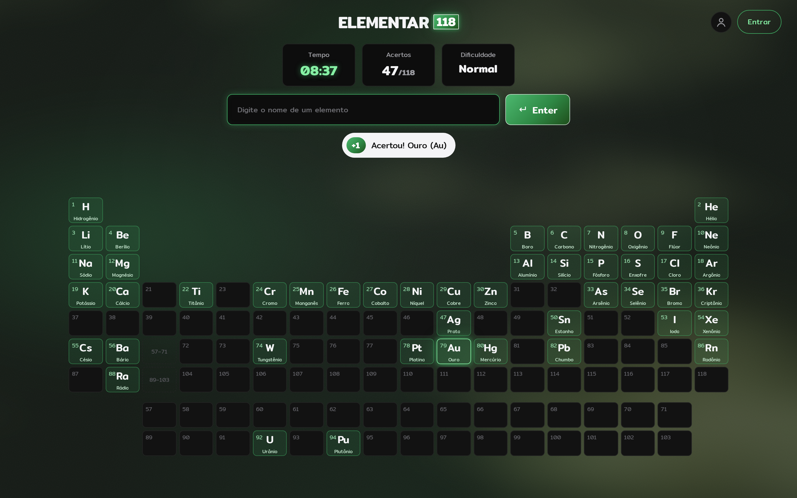
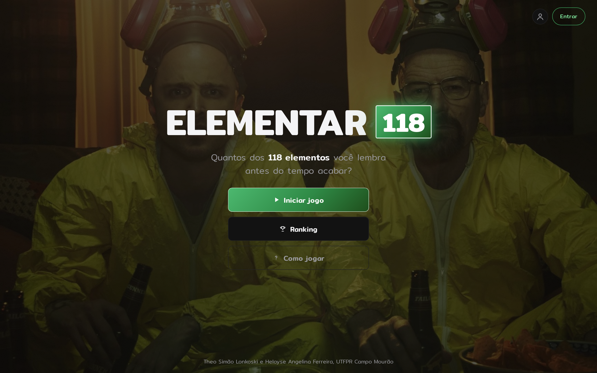
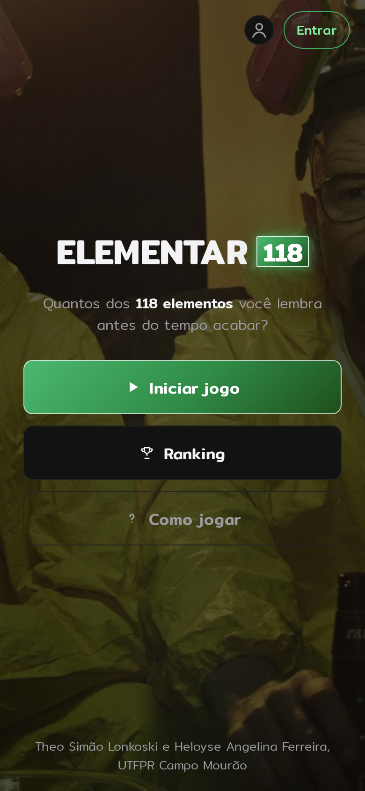
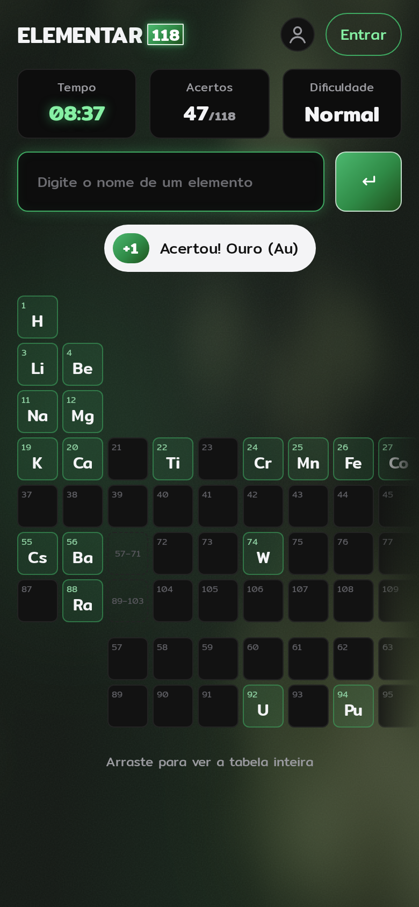
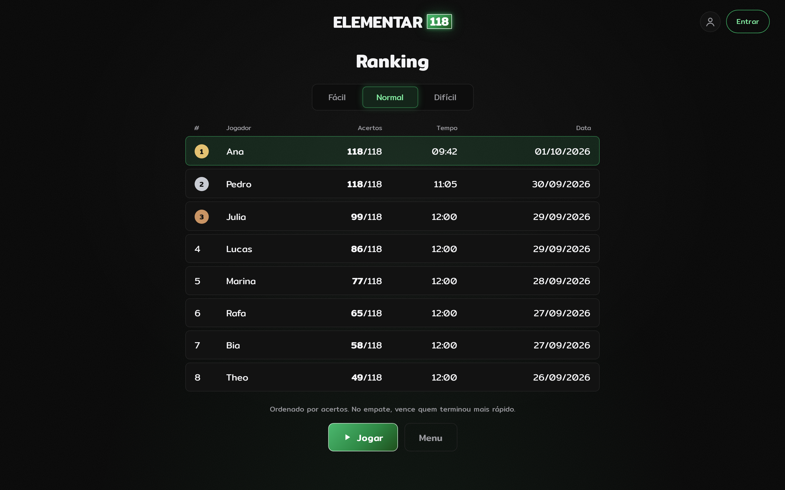
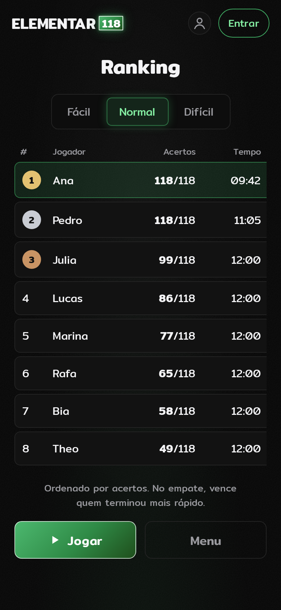

# ELEMENTAR 118

Jogo web para lembrar os **118 elementos da tabela periódica**. A tabela começa em branco e se
completa conforme o jogador acerta os nomes.

Projeto de Análise e Projeto de Sistemas (TI23L), UTFPR Campo Mourão, 2º semestre de 2026.

**Equipe:** Theo Simão Lonkoski e Heloyse Angelina Ferreira



## Regras

- O jogador digita o nome de um elemento e aperta Enter. Acentos, maiúsculas e espaços são
  ignorados, e sinônimos são aceitos (Azoto, Volfrâmio…).
- **Acertou:** a casa acende com o símbolo e o nome, e aparece "+1 Acertou!".
- **Já digitado:** a casa pisca e aparece "já está na tabela".
- **Não existe:** o campo treme e aparece "Esse elemento não existe".
- **Placar:** não há vidas nem pontos. O placar é o número de acertos (x/118). A cada 10 acertos
  aparece "Subiu de nível!".
- **Dificuldade:** muda só o tempo. Fácil 15:00, Normal 12:00, Difícil 10:00.
- **Vitória:** completar os 118. **Derrota:** o tempo zera ou o jogador desiste; os que faltaram
  aparecem destacados.
- **Ranking:** top 10 por dificuldade, salvo no `localStorage`. Ordem por acertos; no empate,
  quem terminou em menos tempo.

## Atendimento à especificação

| Exigência | Onde |
|---|---|
| Tela inicial com nome, instruções, Iniciar e Ranking | Tela Menu · UC01, UC02, UC10 |
| Mecânica principal e pontuação (acertos + tempo) | Tela Gameplay · UC04, UC05, UC06 |
| Estados: andamento, pausa, vitória e derrota | UC04, UC07, UC09 |
| Persistência e ranking | Tela Ranking · UC10, UC13 |
| Feedback (acertou, errou, subiu de nível, fim de jogo) | Tela Gameplay · UC05, UC06, UC09 |
| Jogar novamente e voltar ao menu | UC14 |
| Responsividade | 3 telas em desktop (1440×900) e celular (390×844) |
| **Extras:** níveis de dificuldade, conquistas e tema claro/escuro | UC03, UC11, UC12 |
| Diagrama de casos de uso com `<<include>>` e `<<extend>>` | [docs/casos-de-uso.md](docs/casos-de-uso.md) |
| Histórias de usuário | [docs/historias-de-usuario.md](docs/historias-de-usuario.md) · [.txt](docs/historias-de-usuario.txt) |
| Kanban no Trello | *link do quadro em breve* |

## Protótipos de tela

Os protótipos oficiais são as 3 telas abaixo, em desktop e celular
([`prototipos/neon`](prototipos/neon)). O protótipo navegável está em
[`prototipo-neon/index.html`](prototipo-neon/index.html).

| Tela | Desktop | Celular |
|---|---|---|
| Menu |  |  |
| Gameplay |  |  |
| Ranking |  |  |

Visual: fundo preto com textura, verde dos quadrados de elemento e neon ao passar o mouse.
Fonte **Mitr** (Google Fonts).

## Como rodar

Precisa do [Node.js](https://nodejs.org) 20 ou mais novo.

```bash
npm install      # instala as dependências
npm run dev      # abre o jogo em http://localhost:5173
npm test         # roda os testes automáticos
npm run build    # gera a versão final na pasta dist/
```

Tecnologias: **React + JavaScript** (Vite), CSS puro e `localStorage`. Sem biblioteca de rotas nem de estado.

## Estrutura do código

O código é dividido em camadas. A regra é: a **lógica** não conhece o React, e os **componentes**
não têm regra de negócio.

```
src/
├── dados/          elementos (118 + posição na grade), dificuldades, conquistas
├── logica/         regras do jogo em funções puras: validarResposta, placar, partida, ranking, conquistas
├── armazenamento/  único arquivo que lê e escreve no localStorage
├── hooks/          usePartida (liga a lógica à tela), useCronometro, useTema, useTemporario
├── componentes/    peças reutilizáveis: TabelaPeriodica, Placar, CampoResposta, Avisos, Modal...
├── telas/          Menu, NovaPartida, ComoJogar, Jogo, Pausa, Ranking, Conquistas
├── estilos/        global.css (cores dos temas escuro e claro)
├── App.jsx         escolhe a tela atual
└── main.jsx
tests/              testes automáticos (ver abaixo)
docs/               diagrama de casos de uso e histórias de usuário
prototipo-neon/     protótipo visual de referência (oficial)
```

Cada arquivo começa com um comentário dizendo o que faz e quem o usa.

## Testes automáticos

`npm test` roda mais de 150 testes e também confere o código contra os documentos:

| Arquivo | O que verifica |
|---|---|
| `dados`, `validarResposta`, `placar`, `partida`, `ranking`, `conquistas` | Regras do jogo (HU02 a HU13) |
| `telas.test.jsx` | O jogador usando o jogo de verdade, uma história por vez (HU01 a HU14) |
| `responsividade.test.js` | Regras de CSS do celular (HU15) |
| `documentacao.test.js` | Toda HU e todo UC têm teste; cada `<<include>>`/`<<extend>>` do diagrama tem teste; tempos e mensagens das histórias existem no código; elementos, posições, textos e cores são iguais aos do protótipo |

O nome de cada teste começa com o ID da história (`HU05: ...`) e cada grupo com o caso de uso
(`UC04 <<include>> UC05`), o que liga código, testes e documentação.

## Extras implementados

Níveis de dificuldade (UC03), conquistas (UC11 e UC12) e tema claro/escuro.

## Pastas de apoio

`prototipo/elementos.js` é a primeira versão dos dados dos elementos, usada na prototipação.
O jogo usa `src/dados/elementos.js`, com as mesmas informações e a posição de cada elemento igual
à do protótipo neon (conferida por teste).
